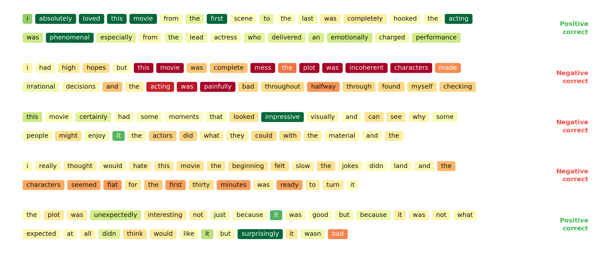
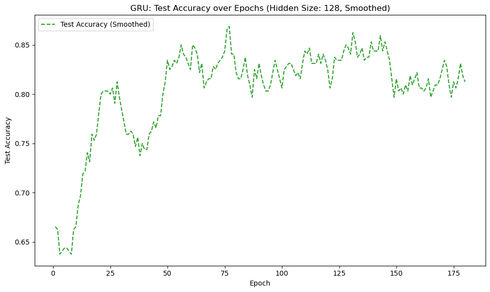
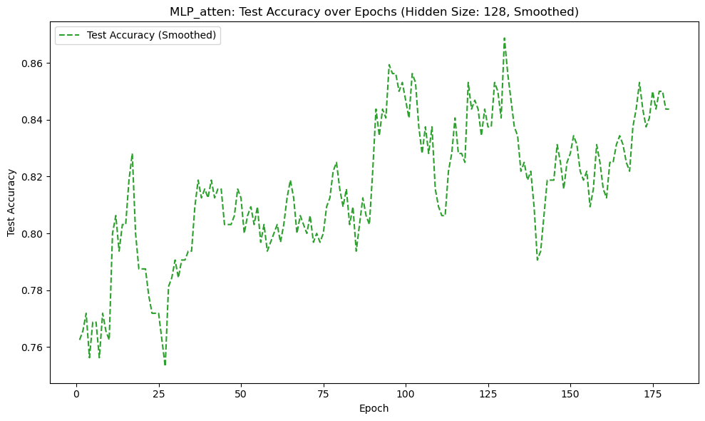

# IMDB Sentiment Analysis — RNN vs GRU vs Attention

Binary sentiment classification of IMDB movie reviews with four architectures **implemented from scratch in PyTorch**: a vanilla RNN, a GRU, a token-wise MLP and a token-wise MLP with **restricted self-attention**.

The token-wise models score every word separately, so you can see *why* the model made its decision:

<p align="center">
  
</p>

<sub>Each word is colored by its contribution (green = positive, red = negative). These are the real scores produced by the trained attention model on hand-written test reviews.</sub>

## Results

| Model | Hidden size | Test accuracy (approx.) | Notes |
|---|---|---|---|
| Vanilla RNN | 64 / 128 | ~55 %, unstable | vanishing gradients, weak memory; a larger hidden size doesn't help |
| GRU | 64 / 128 | ~82–85 % | gates make learning faster and steadier; 128 is slightly smoother |
| Token-wise MLP | 128 | ~80 % | strong on clear-cut reviews, fooled by "brilliant… but a disaster" |
| **MLP + restricted self-attention** | 128 | **~84 %** | best model: +4 points accuracy and −0.1 test loss over the plain MLP |

<table>
  <tr>
    <td></td>
    <td></td>
  </tr>
  <tr>
    <td align="center">GRU (hidden 128)</td>
    <td align="center">MLP + self-attention (hidden 128)</td>
  </tr>
</table>

### Error analysis on hand-written reviews

Four reviews were written to probe each outcome (true/false positive, true/false negative):

| Review | Plain MLP | MLP + attention |
|---|---|---|
| "This movie was a masterpiece. Brilliant, emotional, unforgettable." | ✅ Positive | ✅ Positive |
| "The beginning was brilliant, but eventually it became a complete disaster and waste of time." | ❌ Positive | ✅ Negative |
| "Terrible movie. Boring script, awful acting, and a complete waste of time." | ✅ Negative | ✅ Negative |
| "Started slow and boring, yet eventually I was blown away and cried with joy." | ❌ Negative | ✅ Positive |

The plain MLP averages word scores with no context, so one very strong word ("brilliant", "boring") can outweigh the rest of the sentence. With attention, each word looks at its ±5 neighbours before being scored, which lets the model take contrast words like *but* and *yet* into account.

## How it works

- **Input**: each review is cleaned (links, punctuation and single letters removed), lower-cased and truncated or padded to **100 tokens**. Every token becomes a **GloVe 6B 100-d** embedding.
- **RNN / GRU** (`models.py`): hand-written cells. The GRU uses an update gate `z`, a reset gate `r` and a candidate state; the review is classified from the output at the last time step.
- **Token-wise MLP**: `Linear → ReLU → Linear` applied to every word, giving a 2-class *sub-score* per word. The review score is the mean of the sub-scores, with softmax applied after pooling, in logit space.
- **Restricted self-attention**: after the first layer, each word builds its query and attends to the keys and values of its ±5 neighbours. Learned **relative positional embeddings** are added to the keys. The attended representation then goes through the output layer.
- **Training**: Adam (lr 1e-3), batch size 32, cross-entropy loss, 30k reviews for training and 20k for testing.

## Getting started

```bash
pip install -r requirements.txt

# Data (not included in the repo):
#   data/IMDB Dataset.csv     -> https://www.kaggle.com/datasets/lakshmi25npathi/imdb-dataset-of-50k-movie-reviews
#   data/glove.6B.100d.txt    -> https://nlp.stanford.edu/projects/glove/ (glove.6B.zip)

python train.py --model attention --hidden 128 --epochs 10
python train.py --model gru --hidden 64
```

Each run saves a checkpoint and metrics in `results/`, and its learning curves in `assets/`.

## Project structure

```
data.py      cleaning, tokenization, GloVe lookup, data loaders
models.py    RNN, GRU, TokenMLP and AttentionMLP
train.py     training loop, evaluation, learning-curve plots
assets/      figures used in this README
```

## Context

Built by **Samuel Hayat** and **Yehuda Frist** for the *Introduction to Deep Learning* course at the Hebrew University of Jerusalem. The code was reorganized into standalone modules for this repository; the figures and results above come from the original experiments.
